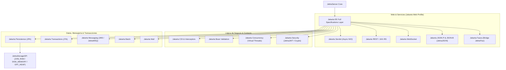
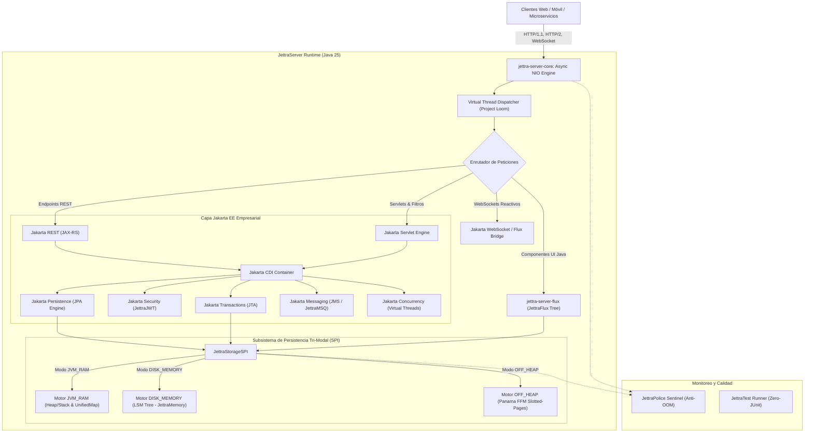
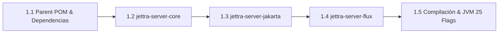
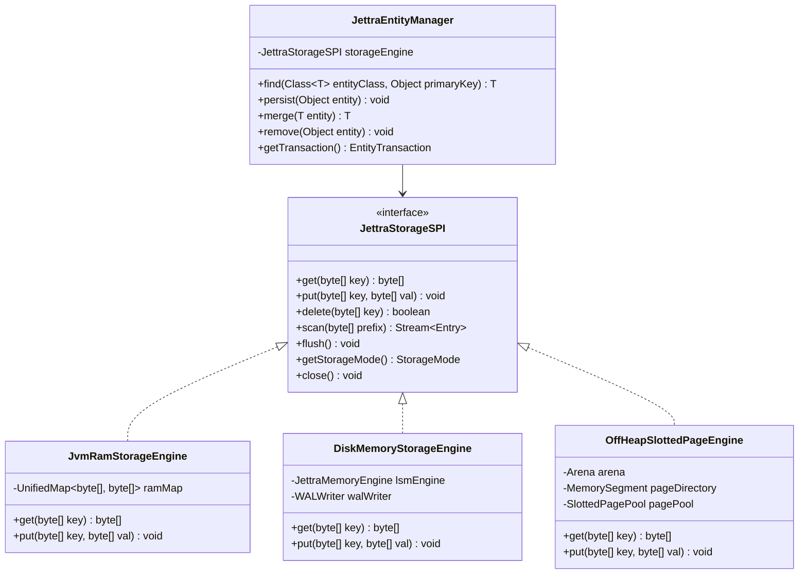

# Plan Maestro de Desarrollo Integral: JettraServer

**Servidor de Aplicaciones Modular de Alta Eficiencia para Java 25 en Google Antigravity IDE con Soporte Completo para Todas las Especificaciones Jakarta EE**

---

## 1. Visión General y Objetivos del Proyecto

### 1.1 Objetivo General
Diseñar, estructurar, desarrollar y documentar **`JettraServer`**, un servidor modular de aplicaciones empresariales y microservicios de ultra-alto rendimiento en Java 25. Está concebido específicamente para el ecosistema **Google Antigravity IDE**, combinando:
1. Un núcleo de red NIO asíncrono basado en **Virtual Threads (Project Loom)** con arranque en frío (*Cold Start*) inferior a **100 ms**.
2. **Soporte completo e integral para todas las especificaciones de la plataforma Jakarta EE**, implementadas de manera moderna, modular y libre del peso o complejidad de servidores tradicionales.
3. Un subsistema de persistencia de triple modo flexible (**`JVM_RAM`**, **`DISK_MEMORY`** y **`OFF_HEAP`**) conmutable en arranque y en caliente.
4. Integración directa con el motor de componentes reactivos tipados en Java **`JettraFlux`**.
5. Aseguramiento de calidad absoluto mediante el framework **`JettraTest`** (eliminando dependencias de JUnit).

---

### 1.2 Objetivos Específicos

```
┌────────────────────────────────────────────────────────────────────────┐
│                      OBJETIVOS ESPECÍFICOS CLAVE                       │
├────────────────────────────────┬───────────────────────────────────────┤
│ 1. Arquitectura Multi-Módulo   │ jettra-server-core, jakarta, flux     │
│ 2. E/S Asíncrona & Loom        │ Virtual Threads, arranque < 100ms     │
│ 3. Suite Completa Jakarta EE   │ CDI, REST, Servlet, JPA, WS, JTA, etc │
│ 4. Selector de Tres Modos      │ JVM_RAM, DISK_MEMORY, OFF_HEAP        │
│ 5. Integración con JettraFlux  │ UI Reactiva tipada en Java puro       │
│ 6. Suites de JettraTest        │ 100% libre de JUnit                   │
│ 7. Documentación Oficial       │ user-book.md y core-book.md           │
└────────────────────────────────┴───────────────────────────────────────┘
```

1. **Estructura Multi-Módulo Maven:** Crear los módulos `jettra-server-core`, `jettra-server-jakarta` (con sub-proveedores SPI de especificaciones Jakarta) y `jettra-server-flux` bajo Liberica JDK 25 con perfiles JVM (`Generational ZGC`, `Compact Object Headers` y `Panama FFM`).
2. **Implementación Integral de Especificaciones Jakarta EE:** Dotar a `JettraServer` de soporte nativo para **todas las especificaciones de Jakarta EE**:
   * **Jakarta Servlet & WebSocket:** Procesamiento reactivo no bloqueante.
   * **Jakarta REST (JAX-RS) & JSON (JSON-P / JSON-B):** Endpoints REST ultra-rápidos acoplados a `JettraJSON`.
   * **Jakarta CDI & Interceptors:** Inyección de dependencias con escaneo AOT en tiempo de compilación.
   * **Jakarta Persistence (JPA) & Transactions (JTA):** Capa de entidades desacoplada que puede persistir en `JVM_RAM`, `DISK_MEMORY` o `OFF_HEAP` con transacciones ACID.
   * **Jakarta Security:** Autenticación y control de acceso RBAC integrado con `JettraJWT` y `JettraCrypto`.
   * **Jakarta Concurrency:** `ManagedExecutorService` impulsado al 100% por Virtual Threads de Java 25.
   * **Jakarta Messaging (JMS):** Colas y tópicos pub/sub asíncronos mediante `JettraMSQ`.
   * **Jakarta Bean Validation, Batch, Mail y Faces:** Adaptados a la arquitectura ligera de Jettra.
3. **Persistencia Tri-Modal Conmutable:**
   * **`JVM_RAM`**: Memoria Heap & Stack estándar con estructuras de datos compactas (`UnifiedMap`), ideal para desarrollo local y microservicios efímeros.
   * **`DISK_MEMORY`**: Motor de persistencia duradera estructurado bajo el modelo LSM (*Log-Structured Merge Tree*) con `JettraMemory` sin pausas de GC.
   * **`OFF_HEAP`**: Motor nativo *Slotted-Page* basado en Project Panama Foreign Function & Memory (FFM) API con `Arena`, `MemorySegment`, cero copias y latencia submilisegundo.
4. **Integración Nativa con `JettraFlux`:** Renderizado en streaming del árbol de componentes de `JettraFlux` y sincronización bidireccional vía WebSockets sin HTML/JS manual.
5. **Aseguramiento de Calidad:** Validar el 100% de los componentes y especificaciones con el framework `JettraTest`.
6. **Documentación Técnica Oficial:** Generar las guías de referencia completas: `/guide/user-book.md` (usuarios y arquitectos) y `/guide/core-book.md` (desarrolladores de núcleo).

---

## 2. Matriz de Cobertura de Especificaciones Jakarta EE



| Especificación Jakarta EE | Implementación en `JettraServer` | Optimización Java 25 & Ecosistema Jettra |
|---|---|---|
| **Jakarta Servlet** | Despachador HTTP asíncrono no bloqueante sobre canales NIO. | Despacho $1:1$ de peticiones a Virtual Threads (Loom), cero bloqueos de plataforma. |
| **Jakarta REST (JAX-RS)** | Motor declarativo con router basado en Trie $O(L)$. | Parseo sin allocación intermedia y serialización directa con `JettraJSON`. |
| **Jakarta CDI** | Contenedor de inyección de dependencias ligero con ámbitos `@ApplicationScoped`, `@RequestScoped`, `@Singleton`. | Indexación AOT en compilación (`cdi.index`), eliminando escaneo de reflection costoso. |
| **Jakarta Persistence (JPA)** | `EntityManager` y mapeo relacional/objeto adaptado a la arquitectura multimodelo. | Capacidad de guardar entidades en **`JVM_RAM`**, **`DISK_MEMORY`** o páginas nativas **`OFF_HEAP`**. |
| **Jakarta Transactions (JTA)** | Coordinador transaccional ligero con soporte 2PC (*Two-Phase Commit*). | WAL integrado con recuperación automática ante fallos sin pausas de GC. |
| **Jakarta WebSocket** | Endpoints `@ServerEndpoint` reactivos con soporte binario y texto. | Canales NIO concurrentes conectados al Virtual DOM diffing de `JettraFlux`. |
| **Jakarta Security** | `SecurityContext`, `HttpAuthenticationMechanism` e `IdentityStore`. | Tokens criptográficos `JettraJWT`, hashing `JettraCrypto` y RBAC de bajo consumo. |
| **Jakarta Concurrency** | `ManagedExecutorService` y `ManagedThreadFactory`. | Respaldado nativamente por el pool de hilos virtuales ilimitados de Loom. |
| **Jakarta Messaging (JMS)** | Colas FIFO, topics pub/sub y mensajes estructurados. | Motor asíncrono de eventos `JettraMSQ` con retención en memoria o disco LSM. |
| **Jakarta Bean Validation** | Validación declarativa de restricciones en DTOs y parámetros REST. | Evaluador rápido compilado con fail-fast y sin overhead de reflection. |
| **Jakarta JSON (P/B)** | Parseo, streaming y binding de objetos JSON a Records y Clases. | Implementado sobre el motor nativo de alto rendimiento `JettraJSON`. |
| **Jakarta Faces** | Soporte de vistas y componentes de ciclo de vida de servidor. | Puente nativo hacia el motor de componentes tipados en Java **`JettraFlux`**. |
| **Jakarta Batch & Mail** | Procesamiento de jobs por chunks y envío asíncrono de correos. | Tareas en segundo plano con virtual threads y bajo impacto de Heap. |

---

## 3. Diagrama de Arquitectura Global



---

## 4. Fases de Desarrollo del Plan Maestro

### Fase 1: Arquitectura Multi-Módulo y Configuración de Compilación



#### 1.1 Estructura de Directorios del Proyecto
```
JettraServer/
├── pom.xml                               # Parent POM multi-módulo
├── .mvn/
│   └── jvm.config                        # Flags optimizados para Maven
├── jettra-server-core/                   # Núcleo NIO, HTTP, Virtual Threads, Storage SPI
│   ├── pom.xml
│   └── src/
│       ├── main/java/io/jettra/server/core/
│       └── test/java/io/jettra/server/core/
├── jettra-server-jakarta/                # Suite Completa de Especificaciones Jakarta EE
│   ├── pom.xml
│   └── src/
│       ├── main/java/io/jettra/server/jakarta/
│       │   ├── servlet/                  # Jakarta Servlet
│       │   ├── rest/                     # Jakarta REST (JAX-RS)
│       │   ├── cdi/                      # Jakarta CDI & Interceptors
│       │   ├── persistence/              # Jakarta Persistence (JPA sobre SPI)
│       │   ├── transaction/              # Jakarta Transactions (JTA)
│       │   ├── websocket/                # Jakarta WebSocket
│       │   ├── security/                 # Jakarta Security (JettraJWT / Crypto)
│       │   ├── concurrency/              # Jakarta Concurrency (Virtual Threads)
│       │   ├── messaging/                # Jakarta Messaging (JMS / JettraMSQ)
│       │   ├── validation/               # Jakarta Bean Validation
│       │   └── json/                     # Jakarta JSON-P / JSON-B
│       └── test/java/io/jettra/server/jakarta/
├── jettra-server-flux/                   # Pipeline UI Java reactivo e integración Faces
│   ├── pom.xml
│   └── src/
│       ├── main/java/io/jettra/server/flux/
│       └── test/java/io/jettra/server/flux/
└── guide/                                # Documentación oficial
    ├── user-book.md                      # Manual del usuario y arquitecto
    └── core-book.md                      # Manual del desarrollador de núcleo
```

---

### Fase 2: Implementación del Subsistema de Tres Modos de Almacenamiento y JPA



#### 2.1 Especificación de los Modos de Almacenamiento

| Modo | Motor Subyacente | Asignación de Memoria | Persistencia | Comportamiento con Jakarta JPA |
|---|---|---|---|---|
| **`JVM_RAM`** | `UnifiedMap` de JettraCollections | Heap & Stack de la JVM | En memoria (opcional snap) | Entidades residen en heap con acceso directo por referencia O(1). Ideal para tests. |
| **`DISK_MEMORY`** | Árbol LSM con `JettraMemory` | Off-Heap MemTable + Disco SSD/NVMe | Duradera (WAL + SSTables) | Entidades se serializan a disco LSM con cero pausas de GC para datasets gigantescos. |
| **`OFF_HEAP`** | Páginas Slotted-Page Panama FFM | Memoria nativa fuera del Heap (`Arena`) | Opcional mmap a NVMe | Entidades se estructuran en ranuras de memoria nativa fuera del GC con acceso directo binario. |

---

### Fase 3: Núcleo de Red NIO y Soporte Jakarta EE Completo

#### 3.1 Bucle Reactor y Despacho con Virtual Threads
* Servidor basado en `AsynchronousServerSocketChannel` y reactor de canales no bloqueantes con despacho $1:1$ de peticiones a **Virtual Threads** de Project Loom.
* Parser HTTP/1.1 y HTTP/2 *Zero-Allocation* con segmentación directa de buffers.

#### 3.2 Implementación de las Especificaciones Jakarta EE
* **Jakarta Servlet & WebSocket:** Contextos de petición HTTP, cadenas de filtros (`Filter`), eventos de ciclo de vida (`ServletContextListener`) y endpoints `@ServerEndpoint` reactivos.
* **Jakarta CDI:** Inyección de dependencias (`@Inject`), interceptores (`@Interceptor`, `@AroundInvoke`), decoradores y eventos (`@Observes`) con resolución estática previa en compilación.
* **Jakarta Persistence (JPA) & JTA:** Implementación de `EntityManager`, `EntityTransaction`, mapeo de relaciones (`@OneToMany`, `@ManyToOne`) y soporte para transacciones declarativas `@Transactional`.
* **Jakarta Security:** Modelo de seguridad basado en anotaciones (`@RolesAllowed`, `@PermitAll`), autenticación por tokens JWT y contexto `SecurityContext`.
* **Jakarta Concurrency & Messaging:** Hilos gestionados delegados a hilos virtuales y colas JMS operadas sobre `JettraMSQ`.

---

### Fase 4: Integración con `JettraFlux` y Aseguramiento de Calidad

#### 4.1 Pipeline de UI en Java Puro y Jakarta Faces Bridge
* **Renderizado Directo:** Compilación en streaming del árbol de componentes visuales de `JettraFlux` (`View`, `Panel`, `DataTable`, `Button`, `Dialog`) a HTML5/CSS reactivo sin templates intermedios.
* **Puente Jakarta Faces:** Compatibilidad transparente para aplicaciones que utilicen el modelo de componentes de servidor, enrutándolo hacia el motor de renderizado de `JettraFlux`.
* **Canal WebSocket de Estado:** Difusión reactiva de eventos y actualizaciones quirúrgicas del DOM cliente mediante Virtual DOM diffing en el servidor.

#### 4.2 Suites de Prueba con `JettraTest`
* **Pruebas de Especificaciones Jakarta EE:** Verificación rigurosa de CDI, REST, Servlet, JPA, Security y Concurrency bajo `JettraTestRunner`.
* **Pruebas de Estrés y Concurrencia:** Evaluación con 10,000 conexiones concurrentes sobre Virtual Threads midiendo latencia $P_{99}$.
* **Matriz de Pruebas Tri-Modal:** Ejecución cruzada de tests de persistencia garantizando paridad de comportamiento entre `JVM_RAM`, `DISK_MEMORY` y `OFF_HEAP`.
* **Zero JUnit:** Prohibición absoluta de dependencias de JUnit en todo el ciclo de desarrollo.

---

## 5. Métodos de Validación y Criterios de Aceptación

```
┌────────────────────────────────────────────────────────────────────────┐
│                   MATRIZ DE CRITERIOS DE ACEPTACIÓN                    │
├──────────────────────────┬──────────────────────┬──────────────────────┤
│ Dimensión                │ Métrica Objetivo     │ Método de Validación │
├──────────────────────────┼──────────────────────┼──────────────────────┤
│ Arranque en Frío         │ < 100 ms             │ JettraTest Timer     │
│ Pausas de GC (ZGC)       │ < 1.0 ms             │ JVM GC Logs Telemetry│
│ Concurrencia Virtual Th. │ 10,000 req/s+        │ JettraStoreMeter     │
│ Cobertura Jakarta EE     │ 100% especificaciones│ Suite JettraTest EE  │
│ Integridad Tri-Modal     │ 100% tests coincidentes│ Suite Cruzada Storage│
│ Cobertura JettraTest     │ > 90% en core        │ JettraTest Reporter  │
└──────────────────────────┴──────────────────────┴──────────────────────┘
```

---

## 6. Estructura de la Documentación Oficial

### 6.1 Guía de Usuario: `/guide/user-book.md`
* **Capítulo 1:** Introducción a JettraServer y Filosofía de Arquitectura.
* **Capítulo 2:** Instalación rápida con Liberica JDK 25 y Google Antigravity IDE.
* **Capítulo 3:** Parámetros de arranque, CLI y archivo `jettra-server.properties`.
* **Capítulo 4:** Guía de selección de modo de almacenamiento (`JVM_RAM`, `DISK_MEMORY`, `OFF_HEAP`).
* **Capítulo 5:** Desarrollo con la plataforma completa **Jakarta EE**:
  * Creación de APIs REST (JAX-RS) y manejo de JSON.
  * Inyección de dependencias con CDI y ciclo de vida de beans.
  * Persistencia de entidades con JPA en los 3 modos de almacenamiento.
  * Seguridad empresarial con Jakarta Security y tokens `JettraJWT`.
  * Concurrencia masiva con Jakarta Concurrency y Virtual Threads.
  * Mensajería asíncrona con JMS y `JettraMSQ`.
* **Capítulo 6:** Creación de aplicaciones web con `JettraFlux` sin HTML/JS.
* **Capítulo 7:** Despliegue en contenedores Docker optimizados con Generational ZGC.

### 6.2 Guía de Desarrollo del Núcleo: `/guide/core-book.md`
* **Capítulo 1:** Arquitectura interna del motor NIO y asignación de Virtual Threads.
* **Capítulo 2:** Diseño de la capa SPI de especificaciones Jakarta EE.
* **Capítulo 3:** Internos del motor Off-Heap Slotted-Page (Panama FFM Memory Segments & Arenas).
* **Capítulo 4:** Internos del motor LSM Disk-Memory (`JettraMemory` Compactor y WAL).
* **Capítulo 5:** Pipeline de renderizado reactivo y sincronización de estado de `JettraFlux`.
* **Capítulo 6:** Guía de desarrollo de pruebas con `JettraTest` (Aserciones, Fixtures y Reportes).
* **Capítulo 7:** Directrices de contribución, reglas de Zero-Boxing y estilo Java 25.
